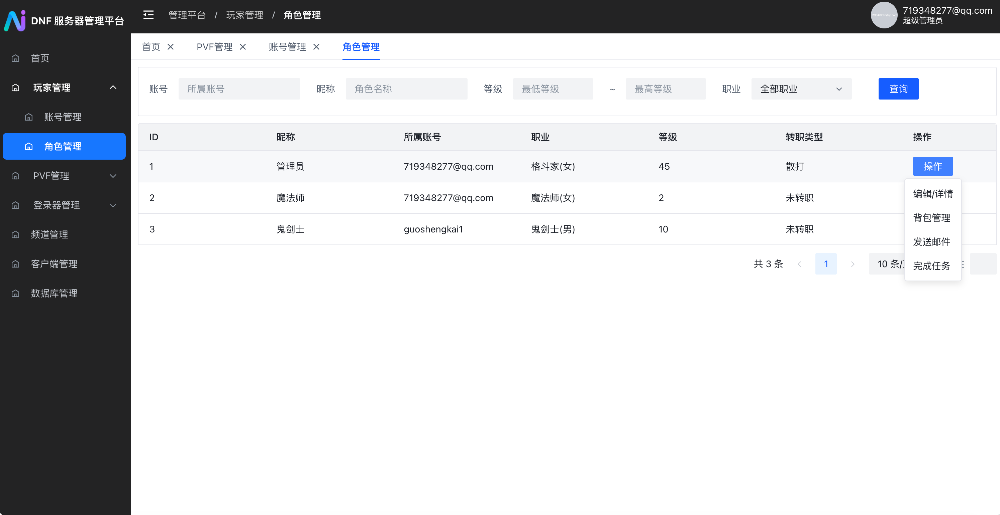
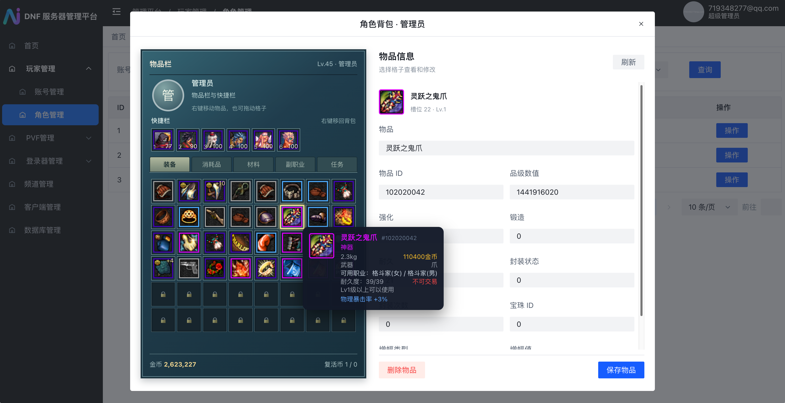
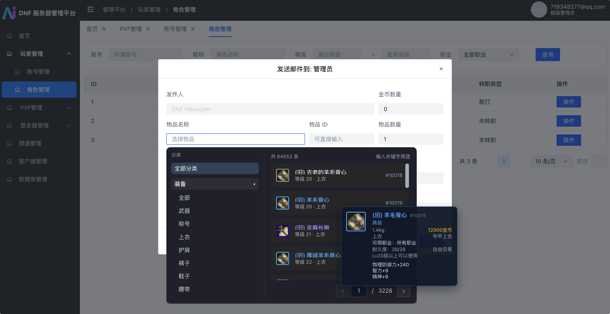
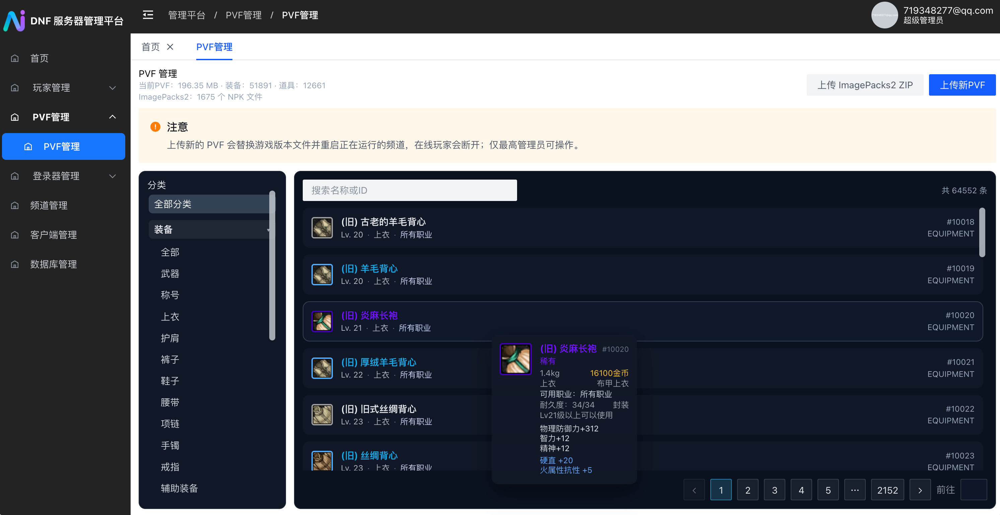
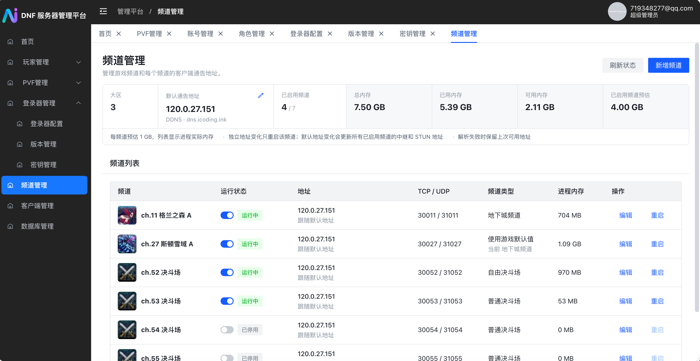
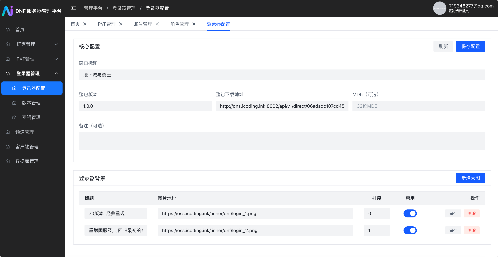
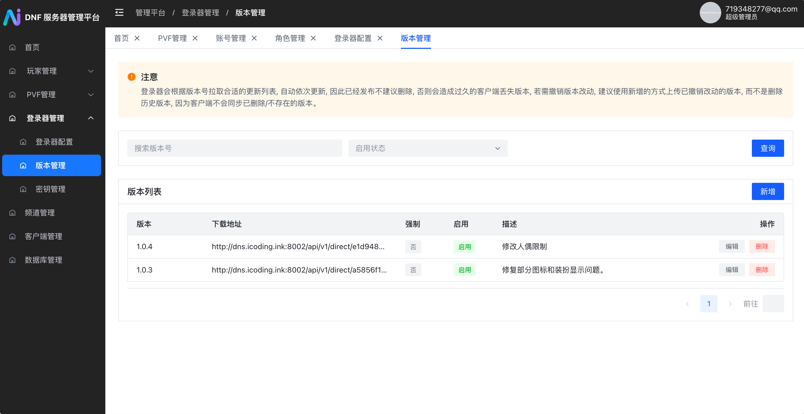
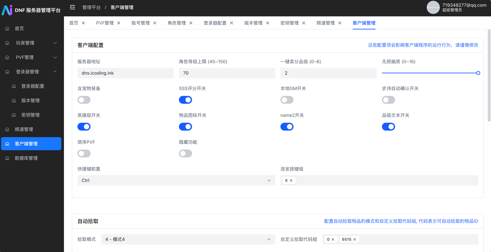
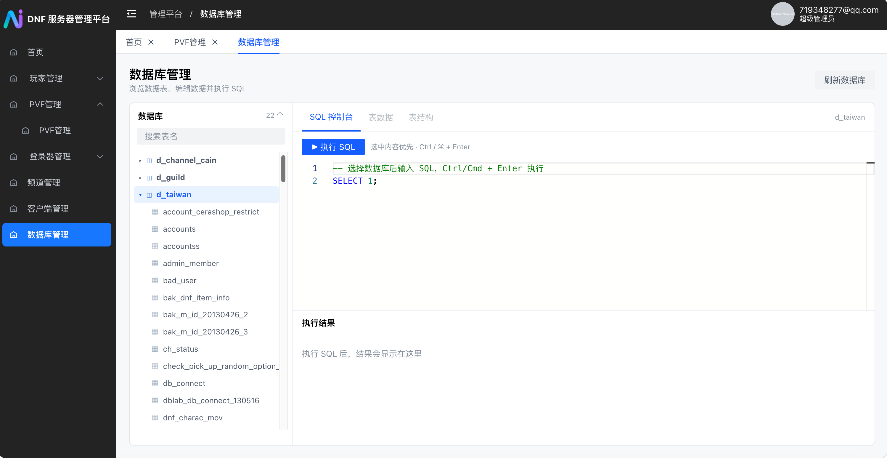

# DNF 服务：集成 DNF 服务器管理平台

本仓库 fork 自 [1995chen/dnf](https://github.com/1995chen/dnf)。原项目将 DNF 服务、数据库及初始化脚本整合进 Docker，支持通过环境变量快速部署；感谢原作者及相关项目为服务容器化所做的工作。本仓库在此基础上集成了 Web 管理平台，提供一套可通过图形界面管理的 DNF 服务端。

这里把游戏服务简称为**服务**，把 DNF 服务器管理平台简称为**平台**。集成镜像包含服务、数据库、Java 运行环境和平台，一个容器即可启动整套服务。

## 相关项目

- [原项目：1995chen/dnf](https://github.com/1995chen/dnf)：本仓库的上游项目。
- [DNF 服务器管理平台：dnf-server-public](https://github.com/onlyGuo/dnf-server-public)：开放的 Web 后台，可独立部署，也可与服务部署在同一宿主机或容器。
- [DNFLogin 登录器](https://github.com/onlyGuo/DNFLogin)：配套登录器，使用平台提供的登录、配置和版本更新接口。
- [PVF/NPK 解析器](https://github.com/onlyGuo/dnf_parser)：平台用于解析游戏资源的项目。

## 相对原项目的主要变化

- **统一管理入口**：平台提供账号、角色、邮件、物品、任务等 GM 运营功能，也能通过页面管理服务；日常操作不再依赖单独的本地 GM 工具。后台按账号角色控制权限，管理员也可以作为玩家登录游戏。
- **角色与背包**：编辑角色属性、浏览和修改背包及快捷栏，向角色发送邮件和物品。
- **频道运维**：新增、编辑、启用、停用和重启频道，无需为单个频道变更重启整个容器或重新运行整套服务。可选择游戏默认类型、地下城、交易、亡者峡谷、普通决斗场、自由决斗场和公平决斗场。页面显示频道进程内存及每频道约 1 GB 的预估。
- **动态地址**：默认通告地址和各频道地址均可配置固定 IPv4 或 DDNS。单频道地址改变时只重启该频道；默认地址改变涉及共用中继和 STUN，还会重新加载相关公共进程和已启用频道。
- **PVF 与资源**：在后台浏览 PVF 中的物品属性，上传自定义 PVF，或上传 `ImagePacks2` ZIP 更新物品图标。更换 PVF 后会重启运行中的频道。
- **登录器和客户端**：后台集中配置登录器标题、背景、整包地址与更新版本，以及客户端的服务器地址、等级上限、画质、自动拾取等选项，具体生效范围取决于配套客户端的实现。
- **数据库与密钥**：超管可浏览数据库、编辑数据并执行 SQL；也可上传匹配的公私钥对或重新生成密钥，并同步至服务。

平台与 DNFLogin 提供统一的管理和登录入口；使用平台管理不需要额外运行本地 GM 工具。

## 快速开始

在 Linux 宿主机安装 Docker 后，将以下地址和密码替换为自己的配置，然后运行：

```bash
mkdir -p /srv/dnf/data /srv/dnf/mysql /srv/dnf/log /srv/dnf/platform

docker run -d --name dnf --hostname dnf --restart unless-stopped \
  --network host --cap-add NET_ADMIN --shm-size 8g \
  -e DNF_HOST_NETWORK=true \
  -e PUBLIC_IP=服务器可访问的IPv4 \
  -e SERVER_GROUP=3 \
  -e SERVER_GROUP_DB=cain \
  -e OPEN_CHANNEL=11,52 \
  -e DNF_DB_ROOT_PASSWORD=替换数据库密码 \
  -e DNF_DB_GAME_PASSWORD=替换为8位密码 \
  -e WEB_USER=替换Supervisor用户名 \
  -e WEB_PASS=替换Supervisor密码 \
  -v /srv/dnf/data:/data \
  -v /srv/dnf/mysql:/var/lib/mysql \
  -v /srv/dnf/log:/home/neople/game/log \
  -v /srv/dnf/platform:/data/dnf-admin \
  guoshengkai/dnf-server:dnf-integrated
```

`DNF_DB_GAME_PASSWORD` 需要 8 位。首次启动后访问 `http://服务器地址:8003/login`；没有超管时，已有的第一个账号会被设为超管，空账号库的第一个注册账号会成为超管。完成启动后，可在平台配置频道及 DDNS。

`/srv/dnf` 保存数据库、PVF、频道配置、密钥和日志，请按需备份。`OPEN_CHANNEL` 只在首次导入时使用，后续在平台管理频道。

## 端口

以下为默认的 3 区配置：

| 用途 | 端口 |
| --- | --- |
| 平台 | TCP 8003 |
| 游戏公共服务 | TCP/UDP 7001、7300；UDP 2311–2313 |
| 频道 11 | TCP 30011、UDP 31011 |
| 频道 52 | TCP 30052、UDP 31052 |

新增频道时，3 区的 TCP 端口为 `30000 + 频道号`，UDP 端口为 `31000 + 频道号`。例如 27 号频道使用 TCP 30027 和 UDP 31027；请在宿主机防火墙及云安全组中按需放行。

数据库兼容端口为 TCP 3000，是否对外开放请根据自己的环境配置防火墙。

## 功能预览

### 角色、背包和邮件







### PVF 和频道





### 登录器和客户端







### 数据库管理



## 镜像

| 镜像 | 内容 | 已发布架构 |
| --- | --- | --- |
| `guoshengkai/dnf-server:dnf-integrated` | 服务、数据库与平台的一体化镜像 | `linux/amd64` |
| `guoshengkai/dnf-server:latest` | 独立平台镜像，需连接已有数据库 | `linux/amd64` |

```bash
docker pull guoshengkai/dnf-server:dnf-integrated
```

上面的启动示例在 Linux 宿主机使用 host 网络；独立部署平台的示例见[平台项目 README](https://github.com/onlyGuo/dnf-server-public)。宿主机网络使容器共享宿主机网络栈，不需要 `-p` 映射；端口直接占用宿主机端口。详见 [Docker host 网络文档](https://docs.docker.com/engine/network/drivers/host/)。

## 构建与其他资料

从服务项目构建集成镜像的操作、替换平台 JAR 和版本同步见[集成构建说明](build/Centos7-DNF/WEB_INTEGRATION.md)，更多服务管理细节见[服务集成说明](build/Centos7-DNF/web/integration/README.md)。原项目的[环境准备](doc/PrepareLinux.md)、[其他部署方式](doc/OtherDeploy.md)和[服务架构图](doc/ArchitectureDiagram.md)可供参考；其中旧版镜像示例不等同于本文的集成镜像。

上游相关社区项目：[XanderYe/dnf](https://github.com/XanderYe/dnf)、[llnut/dnf](https://github.com/llnut/dnf)。

从旧版升级时，如曾安装宿主机守护服务，需停用该服务并清理其遗留规则。

原项目声明该项目仅供学习使用。
